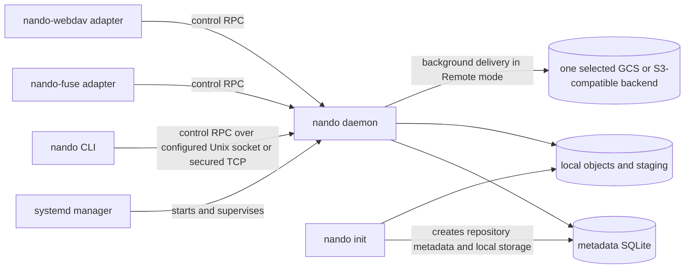

# Overview and architecture

A nando repository is a storage unit. It contains the visible names and directory structure in a metadata database, local content objects, staging data, and repository settings. A file's content is stored as an immutable object identified by a content ID; equal content can share an object. Names and directories are metadata Entries.

The daemon is the process that opens a repository and serves normal operations. A client is a program that sends repository requests to the daemon over its control endpoint. An adapter is a separate client program that presents another way to access the same repository. The systemd unit starts and supervises a daemon process; it is not a separate repository service.

`nando init` creates the repository directly; it does not need a running daemon. In normal use, `nando` commands such as `ls`, `put`, and `get` connect to the daemon. FUSE and WebDAV each run in their own process and also connect to that daemon. The daemon owns the repository and coordinates metadata, local objects, and background remote delivery. Do not start two daemons against the same repository.

The CLI, daemon, FUSE adapter, and WebDAV adapter resolve the repository from an explicit `--repository` option, then `[repository].path` in the shared TOML configuration, then the XDG-style data default (`${XDG_DATA_HOME:-~/.local/share}/nando`). Their daemon endpoint comes from `--daemon-listen`, then `[daemon].listen`, then a repository-derived local Unix socket. A system service usually selects its own config and repository explicitly. Config-file lookup chooses settings; it does not discover a system-wide repository or switch between repositories automatically. See [configuration](../setup/configuration) and [systemd](../setup/systemd).

Each repository uses Local mode or Remote mode with one selected backend. In Local mode, local object storage is the durable authority. In Remote mode, complete content is committed locally first and queued for asynchronous delivery. The metadata transaction records the Entry and its delivery obligation together. A successful write does not confirm remote durability, and the manual does not promise that the system discovers or automatically selects a shared system repository.
