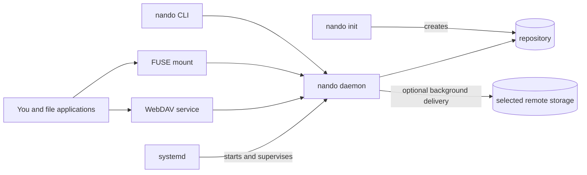

# How nando fits together

A repository is the place where nando keeps a file tree, local file data, and its settings. Start one daemon for a repository. The CLI, FUSE mount, and WebDAV service connect to that daemon; FUSE and WebDAV are separate programs that you start when needed.

`nando init` creates a repository without a running daemon. The daemon provides access to that repository and, in Remote mode, delivers content to its selected GCS or S3-compatible backend in the background. Do not run two daemons against the same repository.

All clients must select the same repository and daemon endpoint. Repository selection uses the first available value in this order:

1. An explicit `--repository` option.
2. `[repository].path` in the shared TOML configuration.
3. The XDG-style data default, `${XDG_DATA_HOME:-~/.local/share}/nando`.

The daemon endpoint follows the same precedence pattern: `--daemon-listen`, `[daemon].listen`, then a local Unix socket derived from the repository path. A system service usually selects its config and repository explicitly. Selecting a config file does not discover a system-wide repository or switch repositories automatically. See [configuration](../setup/configuration) and [systemd](../setup/systemd).

In Local mode, local content is the durable copy. In Remote mode, writes are committed locally first and delivered asynchronously to one selected backend. A successful write does not confirm remote durability. See [remote delivery](../use/remote-delivery).

## Local object publication durability

Local object publication syncs staged file contents on all supported platforms.

On Unix-like systems, nando also syncs the destination directory after
publishing the object and returns directory-sync errors. This relies on the
operating system, filesystem, storage device, and intermediate caches honoring
successful flush requests. It cannot guarantee survival of power loss or
hardware failure if a layer reports a flush complete before data is stable.

On Windows, nando requests `MOVEFILE_WRITE_THROUGH` as a best-effort
publication step. Windows publication does not provide a portable directory
flush and does not guarantee that the published name survives sudden power
loss.

Software-level sync and retry behavior does not prove recovery after an actual
operating-system or hardware power failure.

For the canonical developer design, including internal component responsibilities and data contracts, see [`docs/design.ir.yaml`](https://github.com/kamichidu/go-nando/blob/main/docs/design.ir.yaml).
