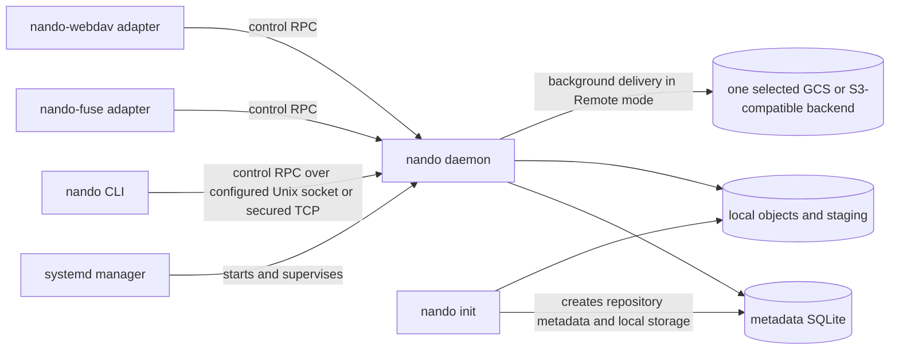

# Overview and architecture

A nando repository is a storage unit. It contains the visible names and directory structure in a metadata database, local content objects, staging data, and repository settings. A file's content is stored as an immutable object identified by a content ID; equal content can share an object. Names and directories are metadata Entries.

The daemon is the process that opens a repository and serves normal operations. A client is a program that sends repository requests to the daemon over its control endpoint. An adapter is a separate client program that presents another way to access the same repository. The systemd unit starts and supervises a daemon process; it is not a separate repository service.

`nando init` creates a repository directly, without a running daemon. The daemon then owns that repository and coordinates metadata, local objects, and background remote delivery. Do not start two daemons against the same repository.

For everyday file access, run FUSE or WebDAV as a separate process connected to the daemon. The CLI provides administration and diagnostics, including `doctor`, `gc`, and Recovery operations. Repository commands connect to the daemon.

Repository selection uses the first available value in this order:

1. An explicit `--repository` option.
2. `[repository].path` in the shared TOML configuration.
3. The XDG-style data default, `${XDG_DATA_HOME:-~/.local/share}/nando`.

The daemon endpoint follows the same precedence pattern: `--daemon-listen`, `[daemon].listen`, then a local Unix socket derived from the repository path. A system service usually selects its config and repository explicitly. Choosing a config file does not discover a system-wide repository or switch repositories automatically. See [configuration](../setup/configuration) and [systemd](../setup/systemd).

Each repository uses one of these delivery modes:

| Mode | Durable authority and behavior |
| --- | --- |
| Local | Local object storage is the durable authority. |
| Remote | Complete content is committed locally first, then queued for asynchronous delivery to one selected backend. The metadata transaction records the Entry and its delivery obligation together. |

A successful write in Remote mode does not confirm remote durability. The system does not automatically discover or select a shared system repository.
